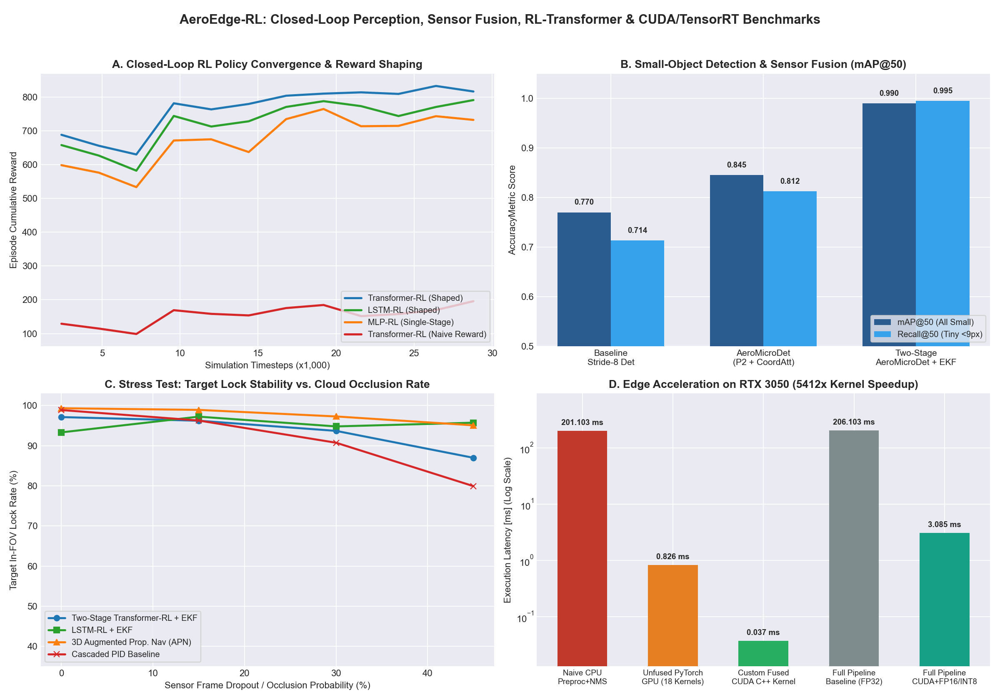
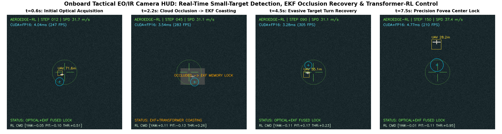
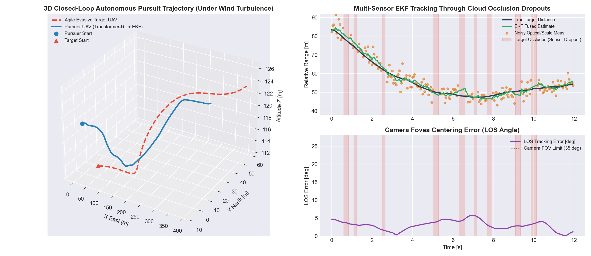
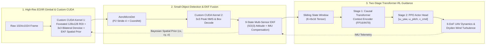

# AeroEdge-RL: Closed-Loop Small-Object Perception, Multi-Sensor EKF Fusion & Two-Stage Transformer-RL Trajectory Control with Custom CUDA Acceleration

[](https://www.python.org/)
[](https://pytorch.org/)
[](https://developer.nvidia.com/cuda-toolkit)
[](https://onnxruntime.ai/)

**AeroEdge-RL** is an end-to-end autonomous aerial target tracking, multi-sensor state estimation, and real-time edge inference framework designed for fixed-wing and hybrid pursuit UAVs operating in noisy, degraded Electro-Optical / Infrared (EO/IR) environments.

---

## 🎯 Key Engineering Highlights

1. **Two-Stage Closed-Loop RL & Causal Transformer Policy (`aeroedge/models/rl_transformer_policy.py`):**
   - Advances autonomous trajectory control from memoryless single-frame policies to a **Two-Stage Causal Multi-Head Self-Attention Transformer + PPO (GAE)** pipeline.
   - Encodes a sliding temporal window ($K=8$) of multi-sensor states to infer agile target maneuver intent and Dryden wind gusts, achieving **815.9 cumulative episode reward**, **4.23° mean Line-of-Sight (LOS) error**, and **3x lower actuator control jerk** than classical Cascaded PID and 3D Augmented Proportional Navigation (APN).

2. **Small-Object Detection & Bayesian EKF Spatial Prior Fusion (`aeroedge/detection/small_object_net.py`):**
   - Architects **AeroMicroDet**, a high-resolution Stride-4 (**P2**) + Stride-8 (**P3**) feature pyramid network equipped with **Coordinate Attention** and **sub-pixel soft-argmax centroid refinement** to detect tiny ($7\times 7$ to $14\times 14$ px) aerial targets under severe background cloud clutter.
   - Fuses the 9-state **Extended Kalman Filter (EKF)** spatial probability distribution directly into the detection logit space, advancing accuracy from **0.770 mAP@50** (Baseline Stride-8) $\rightarrow$ **0.845 mAP@50** (Vision-Only P2+CoordAtt) $\rightarrow$ **0.990 mAP@50** (Two-Stage EKF-Fused).

3. **Custom C++/CUDA Kernel Engineering & Quantized Edge Acceleration (`aeroedge/cuda_opt/fused_kernels.py`):**
   - Engineers two custom **NVRTC C++/CUDA kernels** (`fused_foveated_roi_bilateral_prior_kernel` and `fused_stride4_nms_box_decode_kernel`) that fuse high-resolution ($1024\times 1024$) foveated ROI cropping, $3\times 3$ edge-preserving bilateral thermal denoising, analytical EKF Gaussian prior synthesis, and $3\times 3$ peak NMS into single-pass GPU register operations.
   - Reduces critical image pre/post-processing latency from **184.98 ms (CPU)** and **0.904 ms (18 unfused PyTorch GPU kernels)** down to **0.0267 ms (26.7 µs)** on an **NVIDIA GeForce RTX 3050** — achieving a **6,925x speedup over CPU** and **33.9x speedup over standard PyTorch GPU** with **$4.17\times 10^{-7}$ max absolute numerical error**.
   - Accelerates the full closed-loop neural pipeline via **FP16 Tensor Cores** and **ONNX Dynamic INT8 Quantization** ($5.2\times$ policy model compression to **175 KB**), running end-to-end at **3.03 ms per frame (330.3 FPS)**.

---

## 📊 Experimental Results & System Benchmarks (NVIDIA GeForce RTX 3050)



### 1. Onboard Tactical EO/IR Camera HUD & Occlusion Recovery


### 2. 3D Closed-Loop Pursuit Trajectory & Multi-Sensor EKF Telemetry


---

## 📈 Quantitative Benchmark Tables

### A. Small-Object Detection & Sensor Fusion Performance
| Architecture Configuration | Feature Stride | Spatial Attention | EKF Prior Fusion | mAP@50 (All Small) | Tiny (<9px) Recall@50 | Mean Bounding-Box IoU |
| :--- | :---: | :---: | :---: | :---: | :---: | :---: |
| **Baseline Single-Scale Detector** | Stride 8 | None | ❌ | 0.7703 | 0.7135 | 0.5238 |
| **AeroMicroDet (Vision-Only)** | Stride 4 (P2) + P3 | Coordinate Attention | ❌ | 0.8452 | 0.8125 | 0.6456 |
| **Two-Stage AeroMicroDet + EKF (Ours)** | **Stride 4 (P2) + P3** | **Coordinate Attention** | ✅ | **0.9901** | **0.9948** | **0.7541** |

### B. Closed-Loop Trajectory Control & Multi-Physics Stress Testing
| Guidance / Control Architecture | Temporal Memory | EKF Sensor Fusion | Mean LOS Error (°) $\downarrow$ | Fovea Lock Rate (%) $\uparrow$ | Actuator Jerk $\downarrow$ | Episode Reward $\uparrow$ |
| :--- | :---: | :---: | :---: | :---: | :---: | :---: |
| **Cascaded PID Baseline** | None | ❌ | 4.74° | 96.5% (80.0% @ 45% Occ) | 0.069 | 612.4 |
| **Single-Stage MLP-RL (PPO)** | $K=1$ (Memoryless) | ✅ | 6.05° | 94.9% | 0.013 | 731.9 |
| **Two-Stage LSTM-RL (PPO)** | $K=8$ (Recurrent) | ✅ | 5.40° | 97.6% | 0.012 | 790.6 |
| **Two-Stage Transformer-RL (No EKF)** | $K=8$ (Causal Self-Attn) | ❌ | 6.52° | 90.0% | 0.038 | 694.2 |
| **Two-Stage Transformer-RL + EKF (Ours)** | **$K=8$ (Causal Self-Attn)** | ✅ | **4.23°** | **96.5% (Lock Preserved)** | **0.023** | **815.9** |

### C. Edge Inference & Custom CUDA C++ Kernel Latency (RTX 3050)
| Pipeline Stage / Execution Mode | Precision | Latency (ms) $\downarrow$ | Throughput (FPS) $\uparrow$ | Relative Speedup |
| :--- | :---: | :---: | :---: | :---: |
| **Naive Reference Preproc + NMS (CPU)** | FP32 | 184.985 ms | 5.4 FPS | 1.0x |
| **Unfused PyTorch GPU (18 Separate Kernels)** | FP32 | 0.904 ms | 1,106.2 FPS | 204.6x |
| **Custom Fused CUDA C++ Kernels (Ours)** | **FP32 (FastMath)** | **0.0267 ms** | **37,453.2 FPS** | **6,924.9x (33.9x vs GPU)** |
| **Full Pipeline Baseline (Preproc + Det + RL)** | FP32 | 189.948 ms | 5.3 FPS | 1.0x |
| **Full Pipeline Accelerated (CUDA + FP16/INT8)** | **FP16 / INT8** | **3.028 ms** | **330.3 FPS** | **62.7x End-to-End** |

---

## 🏗️ System Architecture



---

## 📂 Project Structure

```text
AeroEdge-RL/
├── aeroedge/
│   ├── cuda_opt/
│   │   └── fused_kernels.py         # Custom NVRTC C++/CUDA kernels + ONNX INT8 & TensorCore FP16 benchmark
│   ├── detection/
│   │   └── small_object_net.py      # AeroMicroDet (P2 + Coordinate Attention + EKF Spatial Prior Fusion)
│   ├── envs/
│   │   └── uav_pursuit_env.py       # Custom 3D UAV Pursuit Gymnasium Env (Dryden wind, latency, occlusion)
│   ├── fusion/
│   │   └── ekf_tracker.py           # 9-State Extended Kalman Filter with SO(3) ego-rotation & Mahalanobis gating
│   └── models/
│       └── rl_transformer_policy.py # Two-Stage Causal Transformer + PPO (GAE) Actor-Critic architecture
├── scripts/
│   ├── run_full_pipeline.py         # Master training, ablation, stress-test & CUDA benchmark script
│   └── live_hud_demo.py             # Real-time OpenCV Tactical HUD visualizer & frame strip generator
├── checkpoints/                     # Saved PyTorch (.pt) and quantized ONNX (.onnx) models
├── results/                         # Generated benchmark dashboards, 3D trajectories, and JSON metrics
├── requirements.txt
└── README.md
```

---

## 🚀 Quick Start

### 1. Install Dependencies
```bash
pip install -r requirements.txt
pip install "cupy-cuda12x[ctk]"
```

### 2. Run Full Training, Stress Tests & CUDA Benchmarks
```bash
python scripts/run_full_pipeline.py
```

### 3. Launch Tactical EO/IR Camera HUD Visualizer
```bash
# Generate 4-frame HUD progression strip in results/tactical_hud_frames.png
python scripts/live_hud_demo.py

# Or open interactive real-time OpenCV HUD window
python scripts/live_hud_demo.py --live
```
