# AeroEdge-RL: Kapalı Çevrim Küçük Nesne Algılama, Çoklu Sensör EKF Füzyonu ve Özel CUDA Hızlandırmalı İki Aşamalı Transformer-RL Yörünge Kontrol Sistemi

> 🌐 **Dil Seçimi / Language:** [🇬🇧 English Documentation](README.md) | **🇹🇷 Türkçe Dokümantasyon**

[](https://www.python.org/)
[](https://pytorch.org/)
[](https://developer.nvidia.com/cuda-toolkit)
[](https://onnxruntime.ai/)

**AeroEdge-RL**, gürültülü ve zorlu Elektro-Optik / Kızılötesi (EO/IR) hava ortamlarında görev yapan sabit kanatlı ve hibrit takip İHA'ları için geliştirilmiş; uçtan uca **küçük hedef algılama, çoklu sensör durum kestirimi (EKF), derin pekiştirmeli öğrenme (DRL) tabanlı otonom güdüm** ve **düşük seviyeli GPU/Edge hızlandırma** çatısıdır.

---

## 🎯 Temel Mühendislik Katkıları

1. **İki Aşamalı Kapalı Çevrim RL & Causal Transformer Karar Sistemi (`aeroedge/models/rl_transformer_policy.py`):**
   - Otonom yörünge kontrolünü hafızasız (tek karelik) politikalardan **İki Aşamalı Nedensel Öz-Dikkat (Causal Multi-Head Self-Attention) Transformer + PPO (GAE)** boru hattına taşır.
   - Son $K=8$ zaman adımındaki çoklu sensör durum vektörlerini işleyerek çevik hedefin manevra niyetini ve Dryden rüzgar türbülansını kestirir; klasik Kaskad PID ve 3B Oransal Navigasyon (APN) kontrolcülerine kıyasla **815.9 kümülatif bölüm ödülü**, **4.23° ortalama Görüş Hattı (LOS) takip hatası** ve **3 kat daha düşük kontrol sarsıntısı (jerk)** sağlar.

2. **Küçük Nesne Tespiti & Bayesyen EKF Uzamsal Önsel Füzyonu (`aeroedge/detection/small_object_net.py`):**
   - Yoğun bulut ve termal sensör gürültüsü altında çok küçük ($7\times 7$ ila $14\times 14$ piksel) hava hedeflerini tespit etmek için **Stride-4 (P2)** yüksek çözünürlüklü özellik piramidi, **Coordinate Attention** ve **alt-piksel (sub-pixel) soft-argmax merkez iyileştirmesi** içeren **AeroMicroDet** mimarisini sunar.
   - 9-durumlu **Genişletilmiş Kalman Filtresi (EKF)** tarafından üretilen uzamsal olasılık dağılımını doğrudan dedektörün logit uzayına entegre ederek model doğruluğunu **0.770 mAP@50** (Standart Stride-8) $\rightarrow$ **0.845 mAP@50** (Sadece Görüntü P2+CoordAtt) $\rightarrow$ **0.990 mAP@50** (İki Aşamalı EKF Füzyonlu) seviyesine çıkarır.

3. **Özel C++/CUDA Kernel Mühendisliği & Kuantize Edge Hızlandırma (`aeroedge/cuda_opt/fused_kernels.py`):**
   - Yüksek çözünürlüklü ($1024\times 1024$) gimbal karesinden dinamik ilgi bölgesi (Foveated ROI) kırpma, $3\times 3$ kenar koruyucu bilateral termal gürültü bastırma, analitik EKF Gauss önsel haritası sentezi ve $3\times 3$ yerel maksimum NMS kutu çözümleme işlemlerini tek GPU geçişinde birleştiren iki özel **NVRTC C++/CUDA kernel'ı** (`fused_foveated_roi_bilateral_prior_kernel` ve `fused_stride4_nms_box_decode_kernel`) içerir.
   - Kritik görüntü işleme gecikmesini **NVIDIA GeForce RTX 3050** üzerinde **184.98 ms (CPU)** ve **0.904 ms (18 ayrı PyTorch GPU kernel'ı)** seviyesinden **0.0267 ms (26.7 mikrosaniye)** seviyesine indirerek **CPU'ya göre 6,925 kat, standart PyTorch GPU'ya göre 33.9 kat hızlanma** sağlar (maksimum sayısal sapma sadece $4.17\times 10^{-7}$).
   - Sinir ağı çıkarım hattını **FP16 Tensor Core** ve **ONNX Dinamik INT8 Quantization** ($5.2\times$ model küçültme ile **175 KB** politika boyutu) ile hızlandırarak tüm kapalı çevrim sistemi kare başına **3.03 ms (330.3 FPS)** hızda çalıştırır.

---

## 📊 Deneysel Sonuçlar ve Sistem Benchmarkları (NVIDIA GeForce RTX 3050)


### 1. Görev Bilgisayarı Taktik EO/IR Kamera HUD & Bulut Tıkanması (Occlusion) Kurtarma


### 2. 3B Kapalı Çevrim Takip Yörüngesi & Çoklu Sensör EKF Telemetrisi


---

## 📈 Nicel Karşılaştırma Tabloları

### A. Küçük Nesne Tespiti & Sensör Füzyonu Başarımı
| Mimari Yapılandırması | Özellik Adımı (Stride) | Uzamsal Dikkat (Attention) | EKF Önsel Füzyonu | mAP@50 (Tüm Küçük) | Çok Küçük (<9px) Recall@50 | Ortalama Kutu IoU |
| :--- | :---: | :---: | :---: | :---: | :---: | :---: |
| **Standart Tek Ölçekli Dedektör** | Stride 8 | Yok | ❌ | 0.7703 | 0.7135 | 0.5238 |
| **AeroMicroDet (Sadece Görüntü)** | Stride 4 (P2) + P3 | Coordinate Attention | ❌ | 0.8452 | 0.8125 | 0.6456 |
| **İki Aşamalı AeroMicroDet + EKF (Bizim)** | **Stride 4 (P2) + P3** | **Coordinate Attention** | ✅ | **0.9901** | **0.9948** | **0.7541** |

### B. Kapalı Çevrim Yörünge Kontrolü & Çoklu Fizik Stres Testleri
| Güdüm / Kontrol Mimarisi | Zamansal Hafıza | EKF Sensör Füzyonu | Ort. LOS Hatası (°) $\downarrow$ | Fovea Kilit Oranı (%) $\uparrow$ | Kontrol Sarsıntısı (Jerk) $\downarrow$ | Bölüm Ödülü $\uparrow$ |
| :--- | :---: | :---: | :---: | :---: | :---: | :---: |
| **Kaskad PID (Klasik Baz)** | Yok | ❌ | 4.74° | %96.5 (%45 Tıkanmada %80.0) | 0.069 | 612.4 |
| **Tek Aşamalı MLP-RL (PPO)** | $K=1$ (Hafızasız) | ✅ | 6.05° | %94.9 | 0.013 | 731.9 |
| **İki Aşamalı LSTM-RL (PPO)** | $K=8$ (Tekrarlayan) | ✅ | 5.40° | %97.6 | 0.012 | 790.6 |
| **İki Aşamalı Transformer-RL (EKF Yok)** | $K=8$ (Causal Self-Attn) | ❌ | 6.52° | %90.0 | 0.038 | 694.2 |
| **İki Aşamalı Transformer-RL + EKF (Bizim)** | **$K=8$ (Causal Self-Attn)** | ✅ | **4.23°** | **%96.5 (Kilit Korundu)** | **0.023** | **815.9** |

### C. Edge Çıkarım & Özel CUDA C++ Kernel Gecikme Analizi (RTX 3050)
| Boru Hattı Aşaması / Çalışma Modu | Hassasiyet | Gecikme (ms) $\downarrow$ | Kare Hızı (FPS) $\uparrow$ | Bağıl Hızlanma |
| :--- | :---: | :---: | :---: | :---: |
| **Referans Ön-İşleme + NMS (Saf CPU)** | FP32 | 184.985 ms | 5.4 FPS | 1.0x |
| **Standart PyTorch GPU (18 Ayrı Kernel)** | FP32 | 0.904 ms | 1,106.2 FPS | 204.6x |
| **Özel Fused CUDA C++ Kernels (Bizim)** | **FP32 (FastMath)** | **0.0267 ms** | **37,453.2 FPS** | **6,924.9x (GPU'ya göre 33.9x)** |
| **Tam Boru Hattı Baz (Ön-İşleme + Dedektör + RL)** | FP32 | 189.948 ms | 5.3 FPS | 1.0x |
| **Tam Boru Hattı Hızlandırılmış (CUDA + FP16/INT8)** | **FP16 / INT8** | **3.028 ms** | **330.3 FPS** | **Uçtan Uca 62.7x** |

---

## 🏗️ Sistem Mimarisi

```mermaid
flowchart LR
    subgraph Sensor["1. Yüksek Çözünürlüklü EO/IR Gimbal & Özel CUDA"]
        A["Ham 1024x1024 Kare"] --> B["Özel CUDA Kernel 1:\nFoveated 128x128 ROI +\n3x3 Bilateral Filtre +\nEKF Uzamsal Önsel"]
    end

    subgraph Perception["2. Küçük Nesne Tespiti & EKF Füzyonu"]
        B --> C["AeroMicroDet\n(P2 Stride-4 + CoordAtt)"]
        C --> D["Özel CUDA Kernel 2:\n3x3 Tepe NMS & Kutu Çözümleme"]
        D --> E["9-Durumlu Çoklu Sensör EKF\n(SO(3) Dönüş + IMU Kompanzasyonu)"]
        E -. "Bayesyen Uzamsal Önsel (cx, cy, σ)" .-> B
    end

    subgraph Control["3. İki Aşamalı Transformer-RL Güdüm"]
        E --> F["Kayan Durum Penceresi\n(K=8x16 Tensör)"]
        F --> G["1. Aşama: Causal Transformer\nBağlam Kodlayıcı (FP16/INT8)"]
        G --> H["2. Aşama: PPO Aktör Başlığı\n[ω_yaw, ω_pitch, v_cmd]"]
        H --> I["6-DoF İHA Dinamiği &\nDryden Rüzgar Türbülansı"]
        I -. "IMU Telemetrisi" .-> E
    end
```



---

## 📂 Proje Klasör Yapısı

```text
AeroEdge-RL/
├── aeroedge/
│   ├── cuda_opt/
│   │   └── fused_kernels.py         # Özel NVRTC C++/CUDA kernel'ları + ONNX INT8 & TensorCore FP16 hız testi
│   ├── detection/
│   │   └── small_object_net.py      # AeroMicroDet (P2 + Coordinate Attention + EKF Uzamsal Önsel Füzyonu)
│   ├── envs/
│   │   └── uav_pursuit_env.py       # Özel 3B İHA Takip Gymnasium Ortamı (Dryden rüzgarı, gecikme, bulut tıkanması)
│   ├── fusion/
│   │   └── ekf_tracker.py           # SO(3) açısal dönüş kompanzasyonlu & Mahalanobis kapılamalı 9-durumlu EKF
│   └── models/
│       └── rl_transformer_policy.py # İki Aşamalı Causal Transformer + PPO (GAE) Actor-Critic mimarisi
├── scripts/
│   ├── run_full_pipeline.py         # Tüm eğitim, ablasyon, stres testi ve CUDA benchmarklarını çalıştıran ana betik
│   └── live_hud_demo.py             # Gerçek zamanlı Taktik Kamera HUD görselleştirici & MP4/PNG üretici
├── checkpoints/                     # Kaydedilen PyTorch (.pt) ve kuantize ONNX (.onnx) modelleri
├── results/                         # Üretilen benchmark panelleri, 3B yörüngeler, HUD videosu ve JSON metrikleri
├── requirements.txt
├── README.md                        # İngilizce Dokümantasyon
└── README_TR.md                     # Türkçe Dokümantasyon
```

---

## 🚀 Hızlı Başlangıç

### 1. Bağımlılıkların Kurulumu
```bash
pip install -r requirements.txt
pip install "cupy-cuda12x[ctk]"
```

### 2. Tüm Eğitim, Stres Testi ve CUDA Benchmarklarının Çalıştırılması
```bash
python scripts/run_full_pipeline.py
```

### 3. Taktik EO/IR Kamera HUD Simülasyonunun Başlatılması
```bash
# 4 karelik HUD şeridini (results/tactical_hud_frames.png) ve MP4 videosunu üretir
python scripts/live_hud_demo.py

# Canlı pencereyi ekranda açarak gerçek zamanlı izlemek için
python scripts/live_hud_demo.py --live
```
